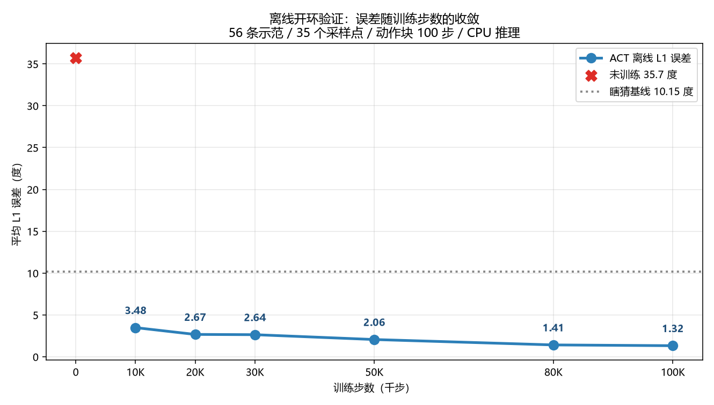
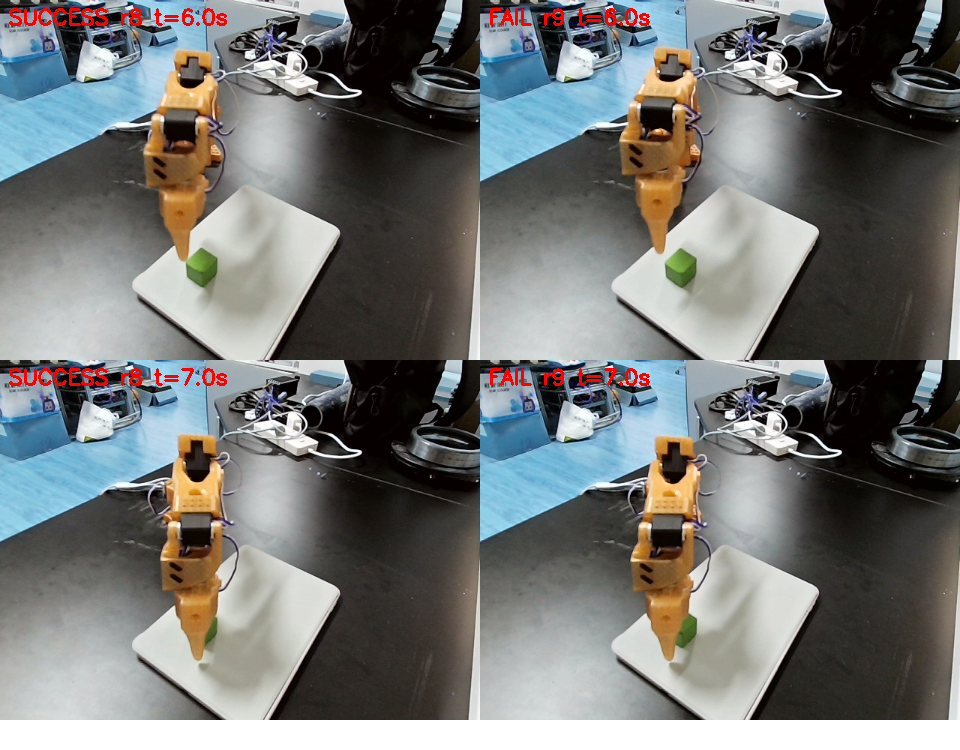
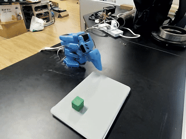

# ACT 复现 · SO-101 抓取绿方块

[ACT (Action Chunking with Transformers)](https://arxiv.org/abs/2304.13705)，2023 年 RSS，所有现代 VLA 的地基——第一次提出"一次预测未来 K 步动作"。

**时间**：2026-11-02 ~ 11-04　**硬件**：SO-101 主从臂 + 单目 USB 相机 + A4000 16G（训练）+ i7 CPU（推理）

## 结果

| 环节 | 结果 |
|---|---|
| 遥操作采集 | **56 条** / 18,794 帧 / 30 fps / 单相机 640×480 |
| 模型 | ACT，**51.6 M** 参数，chunk_size = 100 |
| 训练 | 100,000 步 / batch 8 / **4h12m** / loss 38.9 → 0.060 |
| 离线验证 | 开环 L1 **1.32°**，比"永远输出平均动作"基线好 **87%** |
| **真机成功率** | **9/10 = 90%**（95% CI 60~98%） |
| 推理 | **纯 CPU**，单次 161 ms，满足 30 Hz 实时性 |


*100k 步内的离线 L1 收敛。注意 30k→80k 那段：我中途误判过"已饱和"。*

## 最有价值的一条：30% → 90% 只改了一行

机械臂每轮启动都朝桌面砸下去，约 1.3 秒后才重新看画面。现象很像"模型坏了"，实际是**调用方漏了 `policy.reset()`**：

```
第 5 轮最后一步 raw:  45.8  42.9  -31.9  69.8  -9.4  29.7
第 6 轮第一步   raw:  45.7  43.1  -32.2  70.1  -9.5  27.1
差值:                 0.1   0.2    0.2   0.2   0.0   2.6     ← 同一个动作
```

ACT 的 `select_action()` 在动作队列非空时**不会重新推理**，只 `popleft()`。每轮跑 360 步、每 100 步补队列 → 轮末残留约 40 个动作，下一轮开头继续执行——那是"手臂压在桌面上"的位姿。

定位方法：把每步的「模型原始输出 / 限速后输出 / 实际状态」三组值都落盘。**没有 `raw_` 这一列，永远看不出"新一轮首步 = 上一轮末步"。**


*上排成功轮、下排失败轮，同一时刻。失败那次夹爪偏在方块右侧约 1 cm。*

其余四条问题（复位姿态滑出分布、执行频率 20 Hz vs 训练 30 Hz、电源 5A 峰值不足、单目相机精度上限）都在组会报告 §5 里，每条都附了证伪实验。



## 文件

| 文件 | 内容 |
|---|---|
| [SO101-ACT-复现组会报告.md](./SO101-ACT-复现组会报告.md) | **主报告**：结果、训练配置、五次问题定位的完整因果链、局限 |
| [SO101-ACT-Windows复现手册.md](./SO101-ACT-Windows复现手册.md) | 从零到真机部署的 9 章操作手册（Windows 原生，非 WSL） |
| [DATASET_CARD.md](./DATASET_CARD.md) | 数据集卡片：56 条数据的采集纪律与质量指标 |
| [MODEL_CARD.md](./MODEL_CARD.md) | 模型卡片：结构、训练超参、已知失效模式 |
| `code/` | 批量 rollout、离线评测、绿方块检测、舵机诊断等 10 个脚本 |
| `assets/` | 收敛曲线、预测对比、成功率、失败对比、演示 gif |

### 脚本

| 脚本 | 作用 |
|---|---|
| `batch_rollout.py` | 10 轮自动 rollout + 成功率与置信区间统计，每轮存轨迹 CSV |
| `eval_offline.py` | 离线开环验证（CPU 可跑），输出 L1 与预测对比图 |
| `detect_cube.py` | HSV 绿方块检测，成功率自动判定的核心 |
| `check_episodes_visual.py` | 逐条视觉复核示范是否真抓取 |
| `check_motors.py` / `read_pos.py` | 舵机 ID 扫描 / 关节位置读取 |
| `plot_convergence.py` | 收敛曲线绘制 |
| `run_batch.bat` / `lerobot-env.bat` | 一键批量测试 / 环境激活 |

## 复现要点

- 教程是 Linux 的，本机是 Windows 原生，**6 处必须改**（`/dev/ttyACM1` → `COM4`、`index_or_path: 4` → `1`、`chmod 666` 整段跳过……），见组会报告附录 A。
- lerobot 0.6.x 已把 `lerobot-record --policy.path` 拆成 `lerobot-rollout`，网上老教程照抄会报错。
- **`HF_HOME` 会同时改变校准文件的查找路径**。我为了把数据集缓存挪到 D 盘设了这个变量，结果 `robot.connect()` 认为从未校准，弹出交互提示——按回车就会覆盖原校准文件。
