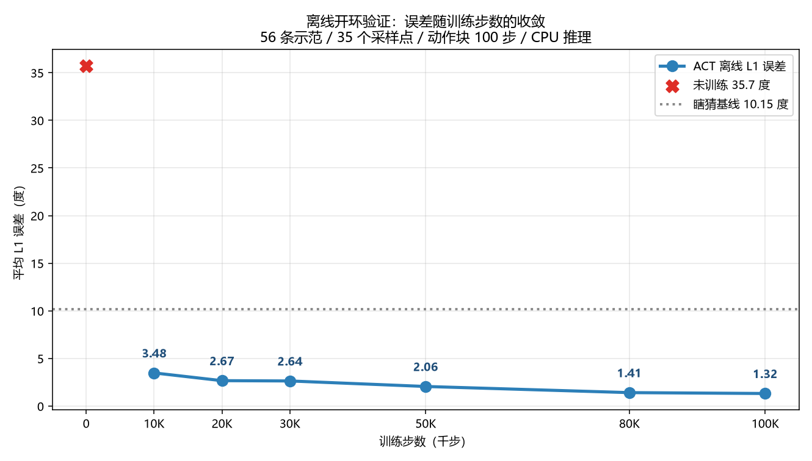
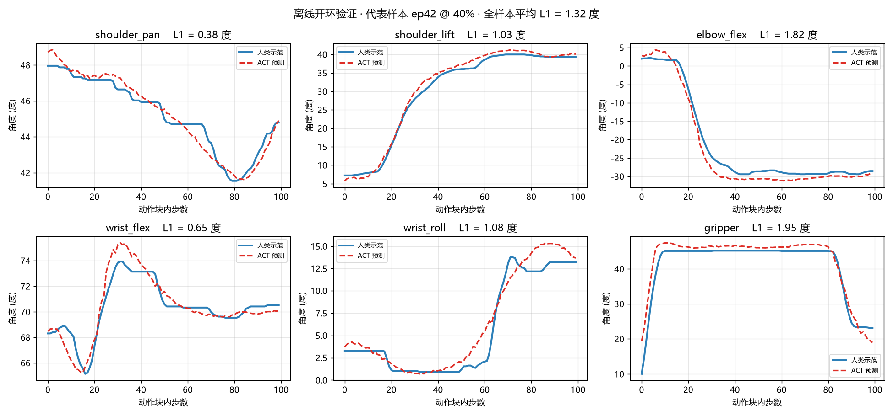
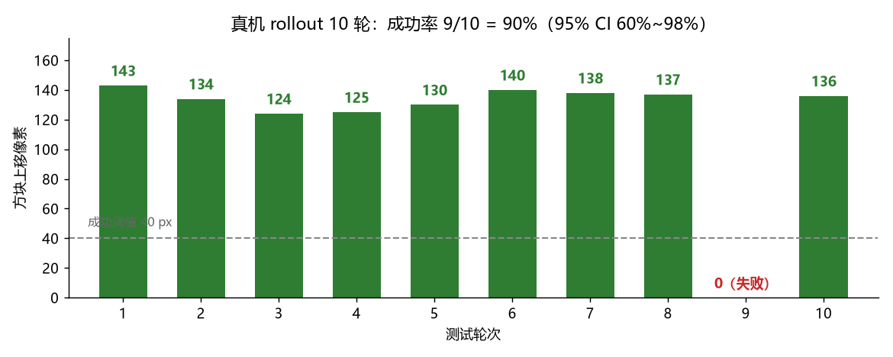
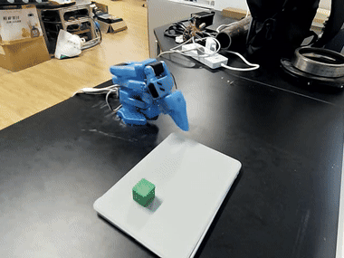
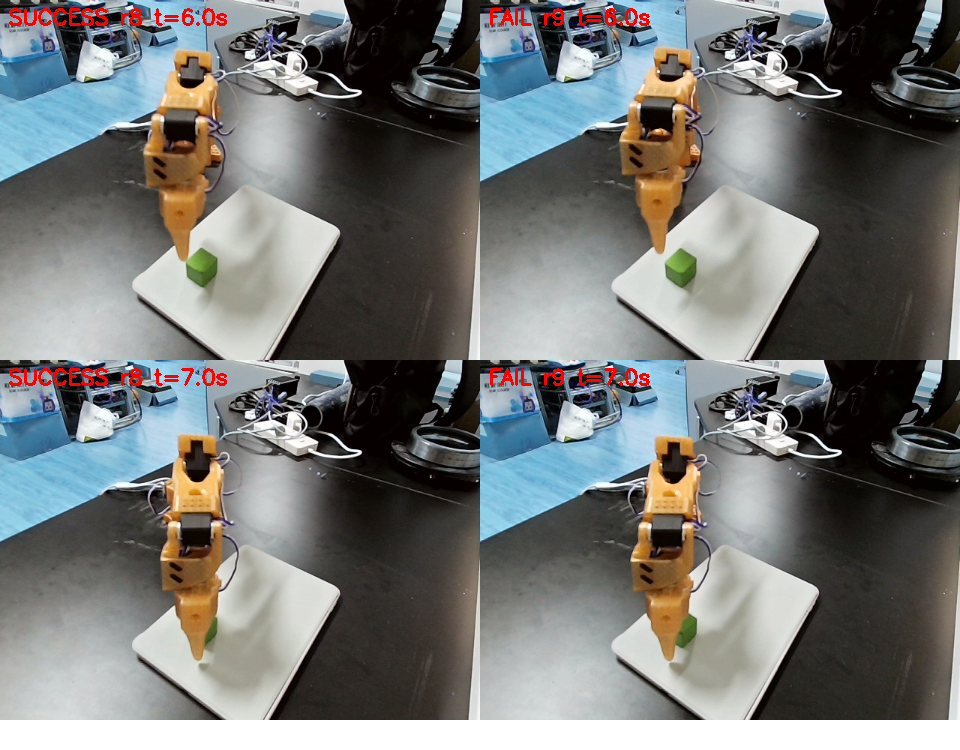

# SO-101 + ACT 复现报告

**任务**：在 SO-101 单臂主从系统上复现 [ACT (Action Chunking with Transformers)](https://arxiv.org/abs/2304.13705)，完成「抓取绿色方块并抬离桌面」的单任务操作。

**时间**：2026-11-02 ~ 2026-11-04
**硬件**：SO-101 主臂 + 从臂、单目 USB 相机、RTX 3050 Laptop（仅用于推理）、NVIDIA A4000 16G（训练）

---

## 0. 一页速览

| 环节 | 结果 |
|---|---|
| 遥操作采集 | **56 条**示范 / 18,794 帧 / 30 fps / 单相机 640×480 |
| 数据质量核验 | 56/56 条真抓取（视觉逐条复核），抬臂行程 127°~169° |
| 模型 | ACT，**51.6 M** 参数，chunk_size = 100 |
| 训练 | 100,000 步 / A4000 / **4 小时 12 分** / loss 38.9 → 0.060 |
| 离线验证（开环 L1） | **1.32°**，比「永远输出平均动作」基线好 **87%** |
| **真机成功率** | **9/10 = 90%**（95% CI 60%~98%） |
| 推理设备 | **CPU（i7，16 核）**，单次推理 161 ms，满足 30 Hz 实时性 |

**一句话结论**：复现成功。离线 L1 1.32° 与真机 90% 成功率相互印证；剩余 10% 的失败可归因于单目相机的横向定位精度，不是控制链路问题。

**本次最有价值的发现**：成功率从 30% 提升到 90%，靠的是定位到一个**调用方漏掉 `policy.reset()`** 的框架陷阱，而非调参。详见第 5.1 节。

---

## 1. 目标与范围

### 1.1 做了什么

按教程 [lerobot101-act 算法复现](https://www.cherish.wang/wiki/2025-12-01-lerobot101-act-suan-fa-fu-xian) 的 9 章流程，在**本机 Windows 原生环境**（非 WSL）上完整走通：

```
环境搭建 → 电机 ID → 校准 → 遥操作 → 相机接入 → 采集 → 训练 → 离线验证 → 真机部署
```

### 1.2 没做什么（明确边界）

- **未做**多任务 / 语言指令：ACT 是 Vision-Action 模型，输入端没有语言分支
- **未做** IsaacLab 仿真（教程第 9 章）：需要 Isaac Lab + A4000 级显卡的完整仿真环境
- **未做**腕部相机：只有 1 路前视相机，这是成功率的瓶颈（见 5.5）
- **未上传**训练过程到云端：全程 `push_to_hub=false`，本地闭环

---

## 2. 系统搭建

### 2.1 硬件与端口

| 项 | 配置 |
|---|---|
| 主臂 leader | SO-101，CH343 串口，**COM3**，序列号 `5AB0183119` |
| 从臂 follower | SO-101，CH343 串口，**COM4**，序列号 `5AB0181464` |
| 相机 | 外接 USB 相机，OpenCV index **1**（index 0 是笔记本内置） |
| 供电 | 从臂 DC 12V / 60W（**5 A**，峰值不足，见 5.4） |

> CH343 的序列号是芯片烧死的，换 USB 口后 COM 号可能变，但序列号不变——这是重新插拔后辨认主从臂最可靠的办法。

### 2.2 软件栈

| 组件 | 版本 |
|---|---|
| Python | 3.12.0（本机 `D:\Python\Python3.12.0`，venv 在 `D:\lerobot-venv`） |
| lerobot | **0.6.1** |
| PyTorch | 2.11.0+cu126（本机）/ 2.11.0+cu130（A4000） |
| 视频后端 | pyav（torchcodec 缺 ffmpeg 库，自动降级，日志里那一大坨 traceback 可无视） |

**本机 GPU 不可用于训练**：RTX 3050 Laptop 4 GB + 驱动 512.28（CUDA 11.6），装不了 cu126+ 的 torch。但**推理可用 CPU**，实测单次 161 ms，动作块 100 步对应 3.3 秒，推理仅占 5% 时间预算。

### 2.3 采集配置与数据画像

```bash
lerobot-record \
  --robot.type=so101_follower --robot.port=COM4 --robot.id=my_follower \
  --robot.cameras="{ front: {type: opencv, index_or_path: 1, width: 640, height: 480, fps: 30}}" \
  --teleop.type=so101_leader --teleop.port=COM3 --teleop.id=my_leader \
  --dataset.repo_id=local/so101_test --dataset.root=D:/lerobot-data/so101_test \
  --dataset.num_episodes=10 --dataset.single_task="Grab the green cube" \
  --dataset.episode_time_s=60 --dataset.reset_time_s=20 --dataset.push_to_hub=false
```

数据分 6 批采集（每批 10 条，`--resume=true` 追加），中途删除 2 条抬臂不足的弱示范。

| 指标 | 数值 |
|---|---|
| 条数 / 帧数 | 56 / 18,794（30 fps） |
| 单条时长 | 8.8 ~ 21.7 秒，中位 **10.4 秒** |
| 抬臂行程（shoulder_lift 极差） | 127° ~ 169°，中位 **150°** |
| 夹爪开合极差 | 25° ~ 73°，中位 43° |
| 静止帧占比 | 29% ~ 61%，中位 **42%** |
| 物体位置变化 | shoulder_pan 起点极差 **34°**（约桌面 15 cm 范围） |

**采集过程中迭代出的三条纪律**（直接反映在数据质量上）：

1. 看到 `Recording episode N` 立刻开始，不要犹豫——静止帧占比从 52~61% 降到 34~48%
2. 完成即按 `→`，不要等 60 秒倒计时跑完——时长从 21 秒压到 10 秒
3. 抓起来必须抬到离桌 10~15 cm 再按 `→`——这是模型判断"抓成功"的关键信号

---

## 3. 训练与离线验证

### 3.1 训练配置

```bash
lerobot-train \
  --dataset.repo_id=<user>/so101_test --dataset.root=~/lerobot-act/so101_test \
  --policy.type=act --policy.device=cuda --policy.push_to_hub=false \
  --output_dir=outputs/train/act_so101 --job_name=act_so101 \
  --steps=100000 --batch_size=8 --wandb.enable=false
```

| 项 | 值 |
|---|---|
| 硬件 | NVIDIA RTX A4000 16 GB |
| batch size | 8 |
| 优化器 | AdamW，lr 1e-5（恒定） |
| 步数 | 100,000（约 41.9 遍数据集） |
| 速度 | 6.7 步/秒 |
| 耗时 | **4 小时 12 分** |
| 最终 loss / l1_loss | 0.060 / 0.060 |
| 产物大小 | model.safetensors **197 MB** |

模型结构（从 `config.json` 读出，非论文值）：

```
ResNet18（1 路 480×640 图像）→ 300 tokens
+ 6 维关节状态 + z(32 维)
→ transformer encoder 4 层 · 512 维 · 8 头
→ transformer decoder 1 层
→ 100 × 6（未来 100 步、6 个关节）
```

> 与论文差异：论文是 **7 层 encoder + 7 层 decoder、4 路相机、80 M 参数**。本复现是 4+1 层、1 路相机、51.6 M——层数少一半才是参数差距的主因，不是相机数量。

### 3.2 离线验证方法

不接真机、不用 GPU 也能验证：从数据集取真实帧 → 过预处理器 → 模型预测未来 100 步 → 与人类示范比对 L1 误差。

**关键设计是对照基线**：如果"永远输出训练集平均动作"的 L1 是 10.15°，而模型是 1.32°，才说明它真的在用视觉信息，而不是靠动作先验。

| checkpoint | 平均 L1 | 中位 | 最差样本 | 相对基线 |
|---|---|---|---|---|
| 未训练（20 步随机权重） | 35.74° | — | — | 差 227% |
| 10K | 3.48° | 3.27° | 9.61° | 好 66% |
| 20K | 2.67° | 2.31° | 9.44° | 好 74% |
| 30K | 2.64° | 2.13° | 11.02° | 好 74% |
| 50K | 2.06° | 1.90° | 8.28° | 好 80% |
| 80K | 1.41° | 1.31° | 2.66° | 好 86% |
| **100K** | **1.32°** | **1.15°** | **4.14°** | **好 87%** |





> 图：6 个关节的预测（虚线）与人类示范（实线）。`shoulder_pan` 差 1.13°、`gripper` 差 0.53°。`shoulder_lift` / `elbow_flex` 存在约 5~10 步的相位滞后——这是**开环预测没有反馈修正**的正常现象，闭环执行时会通过每 100 步重新观测来消除。

**关节量程约 200°，1.32° 相当于 0.66% 的误差。**

### 3.3 一次判断失误的复盘（方法论）

30K 时我看到 20K→30K 只降了 1%，就下结论"20K 基本饱和，继续训收益小"。补测 50K/80K 后被打脸：

```
30K: 2.64°    →    80K: 1.41°     （降 47%）
最差样本: 11.02°  →  2.66°        （改善 4 倍）
```

**教训：不要用两三个点判断收敛趋势。** 平均误差走平可能只是临时的表征重组期，而"最差样本"往往才是真实能力的指标。这条曲线本身也成了报告里最有说服力的一张图——它直接回答"训多久够"。

---

## 4. 真机部署结果

### 4.1 部署配置

```bash
lerobot-rollout \
  --robot.type=so101_follower --robot.port=COM4 --robot.id=my_follower \
  --robot.cameras="{ front: {type: opencv, index_or_path: 1, ...}}" \
  --policy.path=models/100000/pretrained_model \
  --task="Grab the green cube" --strategy.type=base --duration=11 --device=cpu --fps=30
```

> 注意：`lerobot-rollout` 自带的控制循环在 CPU 上只有 **7 Hz**（框架层插值 + telemetry 开销，每步 140 ms），而训练是 30 Hz。后来改为自写的轻量循环（读观测 1.2 ms + 推理 3.6 ms + 发送 0.4 ms）才跑满 **29.5 Hz**。

### 4.2 成功率



| 结果 | 方块上移 |
|---|---|
| 成功（9 次） | 124 ~ 143 px（几乎一致） |
| 失败（1 次） | 0 px |

判定标准（事先固定）：**方块被夹住并抬离平板，画面中上移 ≥ 40 像素**。该标准由 HSV 色块追踪自动判定，不依赖人眼。

### 4.3 演示录像



> 30 Hz 实机执行、CPU 推理，时长 12 秒（gif 为 10 fps 压缩版）。原始录像 640×480 / 30 fps，因体积原因未入库。
>
> 画面中的动作序列：从起始位下降 → 张开夹爪 → 闭合 → 垂直抬起。平板上已空，方块被夹在夹爪中。

### 4.4 与修复前对比

| 阶段 | 成功率 | 限速生效次数/轮 | 首帧突变 |
|---|---|---|---|
| 修复前（队列 bug 在） | 30% / 50% | 69 ~ 105 | 39°~45° |
| **修复后** | **90%** | **1 ~ 6** | ≤27°，多数 10°~13° |

---

## 5. 技术复盘：五个问题的定位过程

这一节是报告的主体。**复现的价值不在于"跑通了"，而在于每个失败现象背后的因果链是怎么被查清的。**

### 5.1 问题一：动作队列残留（决定性，30% → 90%）

**现象**：机械臂一启动就「朝桌面砸下去」，约 1.3 秒后才重新看画面、重新尝试抓取。表现为"发疯"，且**第 1 轮总是成功，第 2 轮起开始出现失败**。

**排查走过的弯路**（三个错误假设，都被数据推翻）：

| 假设 | 如何被推翻 |
|---|---|
| 20 fps 与训练 30 Hz 不匹配导致过冲 | 改回 30 fps 后仍然砸 |
| 复位时夹爪张开到 40° 属分布外，导致 38° 合爪突变 | 改成闭合后突变仍在（只是减小） |
| 电源 5A 不足导致欠压复位 | 电压跌落确实存在，但砸下去发生在电压跌落之前 |

**定位方法（关键一步）**：把每轮每步的「模型原始输出」落盘成 CSV，然后对比相邻两轮的首尾：

```
第 5 轮最后一步 raw:  45.8  42.9  -31.9  69.8  -9.4  29.7
第 6 轮第一步   raw:  45.7  43.1  -32.2  70.1  -9.5  27.1
差值:                 0.1   0.2    0.2   0.2   0.0   2.6     ← 同一个动作
```

**新一轮的第一步，输出的是上一轮的末尾动作。** 这不是巧合。

**根因**（`lerobot/policies/act/modeling_act.py:101`）：

```python
def select_action(self, batch):
    if len(self._action_queue) == 0:
        actions = self.predict_action_chunk(batch)[:, :n_action_steps]
        self._action_queue.extend(actions.transpose(0, 1))
    return self._action_queue.popleft()      # 队列非空 → 不重新推理
```

- 队列长度 = `n_action_steps` = 100，**非空时不会重新推理，只会一直 popleft**
- 每轮跑 360 步、每 100 步补一次队列 → **轮末残留约 40 个动作**
- 我的批处理脚本**从头到尾没有调用 `policy.reset()`**，于是下一轮开头继续执行上一轮末尾那 40 个动作——那是"手臂压在桌面上"的位姿，即"砸下去"

**修复**：

```python
# run_episode() 开头
policy.reset()      # 清空动作队列
```

**验证**：限速生效次数从 69~105 降到 **1~6**，成功率 30%→**90%**。

这条同时解释了之前所有"诡异"现象：第 1 轮必成功（队列是空的）、失败时方块 0 px 不动（前 1.3 秒全在砸桌面）、成功率忽高忽低（取决于残留多少）。

### 5.2 问题二：复位姿态必须落在训练分布内

**现象**：首帧出现 38° 的夹爪突变。

**查证**：统计 56 条示范的**首帧**夹爪值：

```
首帧 gripper: 均值 1.4，范围 1.1~3.7，56/56 条全部 ≤5   ← 全是闭合的
```

而我的复位代码为了"让方块落下"，把夹爪张开到 **40°**——这是训练里从未出现过的起始状态。模型看到"夹爪张开 + 手臂在起始位"，第一个动作只能是"合爪"。

**修复**：复位时夹爪也回到训练首帧值（`goal = target.copy()`，不再覆盖第 5 维）。

**通用原则**：**部署时的初始状态必须落在训练分布内，包括夹爪开度这种看起来无关紧要的维度。**

### 5.3 问题三：控制频率必须与训练一致

**现象**：动作"砸"得更深、过冲明显。

**分析**：训练在 30 Hz，我为了压电流把执行频率降到 20 Hz。一个 100 步的动作块：

```
30 Hz: 100 步 = 3.3 秒     ← 训练时模型预期
20 Hz: 100 步 = 5.0 秒     ← 开环期拉长 1.5 倍
```

这 5 秒里模型"闭着眼睛"按旧计划走，中途不做修正。偏差一旦发生就会**一路走过头**。

**修复**：改回 30 fps。

**通用原则**：ACT 是开环执行 + 定期重观测的架构，**执行频率改变会直接改变开环期的物理时长**，等于改变了模型的闭环特性。

### 5.4 问题四：电源 5 A 峰值不足（硬件瓶颈）

**现象**：跑 2~3 轮后整条总线失联（`no status packet` for ids 1~6），但 Windows 层面**没有任何 USB 掉线记录**，且断开后自动恢复。

**定位**：用 STS3215 自带的电压反馈，在运动过程中采样：

```
静止电压      12.5 V
运动中最电压   4.6 V      ← 跌了 63%
低于 11 V 的采样  4 / 105
t = 37.6 s   ★ 通信失败（复现了问题）
```

**根因**：6 个舵机同时大幅运动时电流峰值远超适配器能力（60 W / 12 V = **5 A**），电压跌落导致舵机欠压复位，整条总线同时失联。

**证据链闭合**：

| 观察 | 解释 |
|---|---|
| 静止 300 次读写 0 失败 | 无电流，电压正常 |
| 小幅运动 0 失败 | 电流小 |
| 大幅复位后失联 | 电流峰值最大 |
| 每次都断在第 2~3 轮 | 电机发热后内阻上升，需求更高 |
| USB 无掉线记录 | 断的不是 USB，是舵机 |
| 断开后自动恢复 | 舵机重启后重新上线 |

**建议**：换 **12 V 10 A（120 W）** 适配器，或在电源输入端并 **4700 μF / 25 V 电解电容**吸收瞬时冲击。

### 5.5 问题五：单目相机的横向定位精度（剩余 10% 的来源）

**现象**：唯一那次失败，夹爪落在方块右缘，卡在边上。

**查证**：把成功轮与失败轮的完整轨迹对比：

```
r08（成功）  lift 行程 146.6°，elbow 范围 -34.1 ~ 93.5
r09（失败）  lift 行程 147.5°，elbow 范围 -35.8 ~ 93.2
```

**轨迹几乎完全相同**，差别只在横向约 1 cm。

**根本限制**：

| 限制 | 量化 |
|---|---|
| 方块在画面中仅约 40 像素宽 | ResNet 输入缩放到 224×224 后只剩约 **14 像素** |
| 只有 1 路相机，无腕部特写 | 论文用 4 路（2 个在腕部），这是其 80~90% 成功率的很大一部分来源 |
| 单目无深度 | 高度判断靠学习，不是测量 |



> 图：上排成功轮，下排失败轮，同一时刻（t=6.0 s / 7.0 s）。失败轮夹爪明显偏在方块右侧。

**这一条不能靠调参解决**，只能改采集条件（加腕部相机 / 相机靠近 / 换更大物体）。

### 5.6 复盘方法论小结

从"机械臂发疯"到"调用方漏了一行"，靠的是三件事：

1. **把中间量落盘**。不只看最终成功率，而是记录每一步的「模型原始输出 / 限速后输出 / 实际状态」三组值。如果没有 `raw_` 这一列，永远看不出"新一轮首步 = 上一轮末步"。
2. **用对照排除假设**。每个假设都设计一个能证伪的实验（静止 vs 运动、小幅 vs 大幅、有无相机、有无 CPU 负载）。
3. **警惕"看起来像模型坏了"**。90% 的"模型发疯"其实是调用契约没满足：状态不在分布内、频率不匹配、内部状态没清空。

---

## 6. 局限

| 局限 | 影响 | 能否在软件层解决 |
|---|---|---|
| 单目相机、方块 40 px | 横向精度约 ±1 cm，成功率上限约 90% | 否，需加腕部相机 |
| 单任务、无语言输入 | 只会抓绿方块，换物体/换指令失效 | 否，需换 VLA 类模型 |
| 电源 5 A | 限制动作速度，快动作会欠压 | 否，需换电源 |
| 训练数据仅 56 条、单一场景 | 换光照/换桌面/换物体位置会明显退化 | 部分，需扩采集 |
| 起始姿态固定（lift 极差仅 5°） | 部署时起始高度差太多会不适应 | 部分，需采多样起始位 |

**已知的数据瑕疵**：物体位置横向范围约 15 cm，但起始高度几乎固定（`shoulder_lift` 起点极差仅 5°）。这意味着模型没有学过"从任意高度出发"，部署时必须把手臂摆到相近的起始位。

---

## 7. 下一步（按性价比排序）

| 优先级 | 事项 | 预期收益 | 成本 |
|---|---|---|---|
| **1** | 换 12 V 10 A 电源 | 去掉电流瓶颈，可跑更快的动作 | ~100 元 |
| **2** | 加腕部 USB 相机（第二路） | 成功率上限从 90% 提到 95%+，直接针对剩余失败 | ~100 元 + 重采数据 |
| **3** | 补 50 条数据，扩大物体位置到 25 cm | 提升泛化边界 | 2~3 小时 |
| **4** | 相机靠近 / 换 3 cm 大方块 | 目标像素从 40 提到 80，成本最低的精度改善 | 10 分钟 |
| **5** | 累计 20~30 轮测试 | 置信区间从 60~98% 收窄到 68~97% | 10 分钟 |

> 第 4 项成本最低但收益不确定（相机是固定的，只能靠挪动物体或换大物体）。第 2 项收益最大，但要重采数据。

---

## 附录 A：与原教程的 5 处适配

教程是 Linux 环境，本机是 Windows 原生，以下 5 处必须改，**每一条都对应一个具体的坑**：

| 教程写法 | 本机实际 | 原因 |
|---|---|---|
| `/dev/ttyACM1` | `COM4` | Windows 没有 tty 设备 |
| `index_or_path: 4` | `index_or_path: 1` | Linux 的 `/dev/video4` 对应 OpenCV 索引 1 |
| `<作者账号>/so101_test` | 自己的 HF 账号 | 原作者的仓库已删除，推不上去 |
| `--dataset.push_to_hub` 默认 | 显式 `=false` | 0.6.1 默认 `True`，不带 `repo_id` 直接报错 |
| `chmod 666 /dev/ttyACM*` | 整段跳过 | Windows 无此概念 |
| `lerobot-find-out` | `lerobot-find-port` | 教程笔误 |

另外教程第 8 章的 `lerobot-record --policy.path=...` 属于旧版 API，0.6.x 已拆分为 `lerobot-rollout`。

---

## 附录 B：关键命令速查

```bash
# 环境
D:\lerobot-work\lerobot-env.bat                  # 激活 venv 并进入工作目录

# 硬件检查
lerobot-find-port                                # 找串口
lerobot-find-cameras opencv                      # 枚举相机（0.6.1 不弹窗，帧存到 outputs/captured_images/）
python check_motors.py COM4                      # 扫舵机 ID（自写）
python read_pos.py COM4                          # 读当前关节位置（自写）

# 校准（只需一次，结果存 ~/.cache/huggingface/lerobot/calibration/）
lerobot-calibrate --robot.type=so101_follower --robot.port=COM4 --robot.id=my_follower
lerobot-calibrate --teleop.type=so101_leader --teleop.port=COM3 --teleop.id=my_leader

# 遥操作
lerobot-teleoperate --robot.type=so101_follower --robot.port=COM4 --robot.id=my_follower \
  --teleop.type=so101_leader --teleop.port=COM3 --teleop.id=my_leader

# 采集（追加模式）
lerobot-record ... --dataset.push_to_hub=false --resume=true

# 删除单条坏示范（自动备份）
lerobot-edit-dataset --operation.type=delete_episodes --operation.episode_indices="[11]" \
  --repo_id=local/so101_test --root=D:/lerobot-data/so101_test \
  --new_repo_id=local/so101_test --new_root=D:/lerobot-data/so101_test --push_to_hub=false

# 训练
lerobot-train --dataset.repo_id=<user>/so101_test --policy.type=act --policy.device=cuda \
  --policy.push_to_hub=false --steps=100000 --batch_size=8 --wandb.enable=false

# 离线验证（本机 CPU，不需要真机）
python eval_offline.py --ckpt models/100000/pretrained_model --episodes 8 --samples 6

# 真机批量测试
run_batch.bat                                    # 双击，10 轮自动统计成功率
```

---

## 附录 C：文件与仓库清单

**本机脚本**（`D:\lerobot-work\`）

| 文件 | 作用 |
|---|---|
| `batch_rollout.py` | 批量 rollout：10 轮自动判定成功率 + 置信区间，每轮存轨迹 CSV 与每 5 步一帧 |
| `run_batch.bat` | 一键启动批量测试（6 秒摆件倒计时，无需按键） |
| `rollout_simple.py` | 单轮 rollout + 完整轨迹 CSV，含自动复位函数 |
| `eval_offline.py` | 离线开环验证（CPU 可跑），输出 L1 与预测对比图 |
| `plot_convergence.py` | 收敛曲线绘制 |
| `check_motors.py` / `read_pos.py` / `probe_ids.py` | 舵机诊断工具 |
| `check_episodes_visual.py` | 逐条视觉复核示范是否真抓取 |
| `detect_cube.py` | HSV 绿方块检测（成功率自动判定的核心） |

**数据与模型**

| 内容 | 位置 |
|---|---|
| 数据集 | `D:\lerobot-data\so101_test`（56 条 / 303 MB） |
| 数据集（云） | `huggingface.co/datasets/w3170700600/so101_test`（私有） |
| 模型权重 | `D:\lerobot-work\models\100000\pretrained_model`（197 MB） |
| 校准文件 | `C:\Users\<user>\.cache\huggingface\lerobot\calibration\` |

---

## 附录 D：一个容易踩的坑（记录备查）

**`HF_HOME` / `HF_LEROBOT_HOME` 会同时改变校准文件的查找路径。**

我为了把数据集缓存放到 D 盘，在脚本里设了 `HF_HOME`，结果 `robot.connect()` 认为"从未校准过"，弹出"把手臂摆到行程中间"的交互提示并卡住——如果当时按了回车，会直接覆盖掉原校准文件。

**结论**：部署脚本里不要碰这两个环境变量；更好的做法是加一道保险——校准文件不存在就直接退出，禁止进入重新校准流程。

---

## 附录 E：第二个坑——LeRobot 相机输出 RGB，不是 BGR

`robot.get_observation()["front"]` 返回的是 **RGB** 数组（LeRobot 内部统一成 RGB，因为策略网络按 RGB 训练）。而 `cv2.VideoWriter` / `cv2.imwrite` 都按 **BGR** 解释输入。

直接写入的后果：**红色和蓝色互换**，蓝色机械臂在录像里变成橙色。

验证方法（同一场景对比两个来源的通道均值）：

```
lerobot 帧 通道0 = 111.0   ↔   cv2 直读 通道2 = 110.9    ← 相同
lerobot 帧 通道2 = 108.8   ↔   cv2 直读 通道0 = 108.8    ← 相同
```

**注意一个陷阱**：绿色通道不受影响，所以用 HSV 找绿色物体的检测脚本**照常工作**，问题被掩盖了——只有肉眼才看得出机械臂变色。如果先看到录像不对再回头查，会误以为是相机白平衡漂移。

修复：

```python
vw.write(cv2.cvtColor(obs["front"], cv2.COLOR_RGB2BGR))       # 写视频
cv2.imwrite(path, cv2.cvtColor(obs["front"], cv2.COLOR_RGB2BGR))  # 存图
```

**策略输入不要做这个转换**——`build_dataset_frame` 之后直接喂给模型，转了反而出错。
