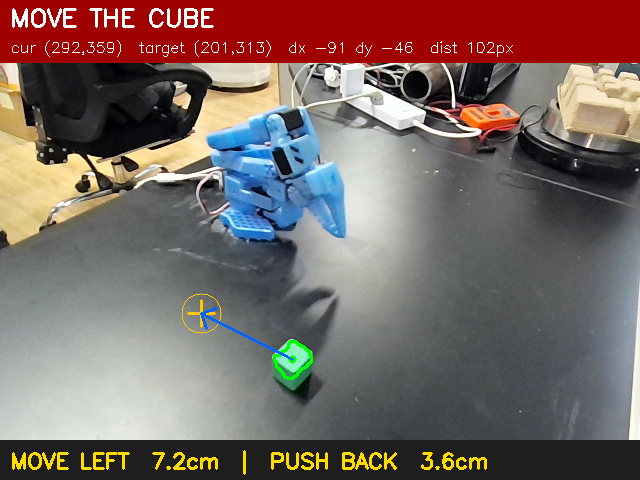

# π0.5 复现 · SO-101 抓取绿方块

[π0.5](https://www.physicalintelligence.company/blog/pi05)（Physical Intelligence）是 3B 级的通用 VLA：PaliGemma 主干 + flow matching 动作专家，支持语言指令与跨本体迁移。这次只做单任务，重点不在"跑通"，而在**验证一个假设：补数据能不能换来泛化**。

**时间**：2026-11-06 ~ 11-10　**硬件**：A4000 16G（链路验证）→ 8 × 3090（正式训练）

## 两阶段结果

### 阶段一：A4000 上把链路跑通（2026-11-07）

| 项 | 结果 |
|---|---|
| smoke test（300 步） | 显存峰值 **14973 / 16376 MiB**，余量 1.4 G，无 OOM |
| 关键约束 | 16G 卡只能 `batch_size=1`，四项省显存配置缺一不可 |
| 正式训练（3000 步） | 1.07~1.18 s/step，约 50 分钟，loss 0.471 → 0.276 后平台期 |
| 离线评测 | holdout MAE 0.4949，**打不过静止基线 0.4742**（−4.4%） |

打不过基线的原因很清楚：`batch=1 × 3000 步 = 3000 个样本`，而训练集有 17,302 帧 → **只跑了 0.17 个 epoch**。对照官方 LIBERO 示例是 30000 步 × batch 64 ≈ 1.9M 样本，差 2~3 个数量级。

→ 结论：**A4000 这条线的价值是"证明配置正确"，正式训练必须上多卡大 batch。**

### 阶段二：8×3090 补数据 + 泛化评测（2026-11-10）

数据从 51 条（单点）扩到 **107 条（老 51 条 + 新 56 条八位置）**，相机不动、只挪方块、3×3 网格；六条完全留出作未见位置测试（P9）。8×3090，batch 4/卡（effective 32），12,000 步 ≈ 11.3 epoch，7 小时 13 分。

| 模型 | 训练数据 | holdout_old（同分布） | **P9（未见位置）** |
|---|---|---|---|
| v1 004500 | 51 条 · 单点 | 0.3763 | **0.4835** |
| v2 004000 | 107 条 · 八位置 | 0.3579 | 0.3657 |
| v2 006000 | 同上 | 0.3547 | 0.3543 |
| **v2 008000** | 同上 | **0.3221** | **0.3362** |
| v2 012000 | 同上 | 0.3276 | 0.3473 |

*归一化空间 MAE，越低越好；stride=10，同一套评测。*

## 泛化判据通过，而且证据不止一个

事先定的判据：新模型 P9 MAE ≤ 老模型 × 0.85 才算真提升。

```
老模型 P9   0.4835
新模型 P9   0.3362  = 老模型的 69.5%   ← 远低于 85% 阈值
```

更有说服力的是"同模型跨位置"这组对比：

| 模型 | 见过的位置 | 没见过的位置 | 换位置掉多少 |
|---|---|---|---|
| v1（单点） | 0.3763 | 0.4835 | **掉 28.5%** |
| v2（八位置） | 0.3221 | 0.3362 | **只掉 4.4%** |

老模型一换位置精度就崩三成——它背的是"纸垫上那一个点"。新模型换到完全没采过的 P9 只掉 4.4%。

相对静止基线的增益差距同样明显：v1 在 P9 上是 +12.4%，v2 008000 是 **+35.7%**。

## 三条结论

1. **补数据的方向完全正确**。56 条多位置数据把未见位置误差压掉 30%，同分布精度还提升了 14%。
2. **不需要更多 epoch，需要更多数据**。8000 步就到顶（7.5 epoch），之后回落（0.3362 → 0.3473），过拟合很轻但确实存在。
3. **绝对精度仍不足**。0.336 的归一化 MAE 换算下来还是厘米级，两指夹爪需要 5 mm 以内。**离线指标改善不等于真机能抓，还没做真机验证。**


*为配合"八位置"采集写的摆件辅助：实时显示当前夹爪与目标点的偏差（这里差 102 px，提示左移 7.2 cm、后推 3.6 cm）。*

## 文件

| 文件 | 内容 |
|---|---|
| [泛化评测报告_v2.md](./泛化评测报告_v2.md) | **核心结果**：107 条数据、checkpoint 扫描、泛化判据检验 |
| [A4000链路验证报告.md](./A4000链路验证报告.md) | 阶段一：A4000 单卡能不能跑 π0.5，显存与配置真相 |
| [runbook.md](./runbook.md) | 完整操作手册：环境、数据切分、训练、评测 |
| [真机部署速查.md](./真机部署速查.md) | 远程推理服务 + SSH 隧道 + 机器人端客户端 |
| [补数据方案.md](./补数据方案.md) | 八位置采集方案的设计与执行 |
| [lerobot文档对齐.md](./lerobot文档对齐.md) | 官方文档与实际代码的差异核对 |
| `code/run_trials.py` | 真机逐轮试验与成功率统计 |
| `code/robot_client.py` | 机器人端 HTTP 推理客户端（dry-run 可脱机验证） |
| `code/check_cube_positions.py` | 方块位置检测，验证摆件是否到位 |
| `assets/` | 摆件辅助截图、数据集帧样例 |

## 踩坑备忘

- `huggingface.co` 不通时必须 `HF_ENDPOINT=https://hf-mirror.com`；`google/paligemma-3b-pt-224` 是 gated，未授权时 tokenizer 返回 403。
- `torchcodec` 缺 `libavutil.so.56` 会加载失败，lerobot 自动 fallback 到 pyav，不必折腾。
- 缓存目录 `du -sh models--lerobot--pi05_base` 只有 72K 是正常的——HF 新版把内容放 `blobs/`，模型目录里只有符号链接。
- 16G 卡跑 π0.5 必须同时开：`freeze_vision_encoder` + `train_expert_only` + `gradient_checkpointing` + `dtype=bfloat16`，少一项就 OOM。
