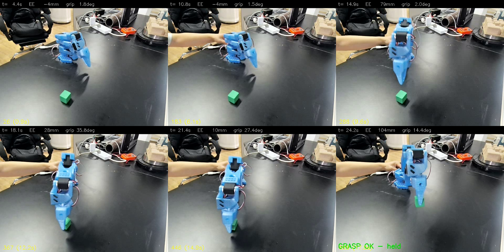
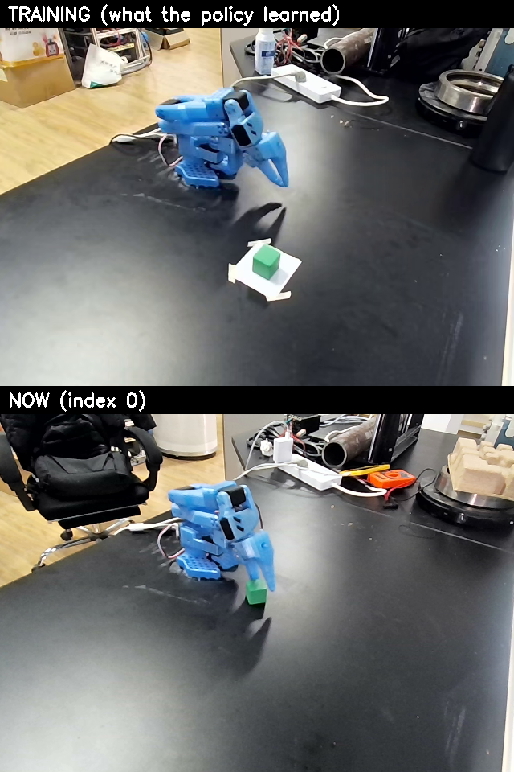

# SmolVLA 复现 · SO-101 抓取绿方块

[SmolVLA](https://arxiv.org/abs/2506.01844)（HuggingFace，2025）——450 M 的轻量 VLA：SmolVLM2-500M 视觉语言主干 + flow matching 动作专家。官方主打"能在消费级显卡上跑"，这次就是来验证这句话。

**时间**：2026-11-05 ~ 11-09　**硬件**：SO-101 follower + 单目前视相机 + A4000 16G（训练）+ **RTX 3050 Laptop 4GB**（真机推理）

## 结果

| 环节 | 结果 |
|---|---|
| 训练数据 | 复用 ACT 那批 **56 条 / 18,794 帧**（LeRobot v3.0，无需转格式） |
| 训练 | A4000，batch 32，**15,000 步 / ~3h**，最终 loss **0.032** |
| 步数选型 | 5k/10k/15k/20k 扫过，15k→20k 只降 0.005° → 饱和（[留出实验结论](./留出实验结论.md)） |
| 离线误差 | 留出集 MAE **1.74°** → 经 URDF 正运动学换算末端 **11.9 mm**（[FK换算结论](./FK换算结论.md)） |
| 真机部署 | **本机 3050 直跑**，显存 **0.9 GB**，单步 p50 **303 ms** |
| 真机成功率 | 固定点位 **17/17**（分三批 5+10+2） |

> **17/17 的口径必须说清楚**：这 17 轮的方块位置 x 249~256、y 369~374，**标准差 1.8 px / 1.0 px，横向跨度 0.5 cm**——它们是同一个点位。只证明"这一点可重复复现"，不证明位置鲁棒性。Wilson 95% 置信区间下限约 82%。

*策略视角六格：待机 → 下降 → 到位 → 张爪 → 合爪 → 提出 104 mm。*

## 三个不靠调参解决的问题

**1. BC 策略没有"我做完了"这个信号。** 方块被夹住抬起后，SmolVLA 不会停，而是继续输出越来越离谱的动作，其中就包括开爪——于是"抓起来、抖两下、自己松手"。而旧判据（画面里方块上移）因为**方块被夹爪挡住**而失效，回合继续跑满 100 秒，最后记成失败。

解法（`code/trial/persistent_trial.py`）：
- 判定改成物理量：正运动学算末端高度，**抬升 ≥55 mm 且夹爪 5.5°~24°（夹着东西）持续 0.25 s** 即成功，方块被挡住也不影响；
- 命中即冻结：停控制回路，把后续动作钳制成触发瞬间的位姿 + 夹爪开度；
- 判定旁听控制回路已有的观测，**零额外总线访问**（原来跨线程轮询是抖动的直接来源）。

离线用 56 条训练回合回放验证：**判据 56/56 命中，全部落在真正抬起来的那一刻**，命中后平均还剩 54 帧（1.8 s）才到原轨迹收尾——正好被砍掉。

**2. 相机编号是个陷阱。** Windows 按枚举顺序分配 USB 相机编号，写死 index 后指到了**笔记本自带摄像头**（画面正对天花板）。方块摆对了却"检测不到"，查了半天。后来按画面内容自动选相机（绿色像素 + 非全黑），结果缓存，每轮存开机画面。

**3. 起始姿态差几度就原地冻结。** 每轮成功回位时夹爪顶住方块，起始姿态累积漂移，后期成功率骤降、机械臂卡住不动。改成每轮程序化校准到训练起始姿态（6 关节，`max_relative_target=30`）后解决。同时把模型加载改成常驻，省掉每轮 30~40 s 的重启开销。

*相机一旦被碰动，视角就漂了——`view_match.py` 用这个对比判断能否复现（<8 px 才算没动）。*

## 诚实的局限

1. **固定位置、单一场景、单一物体**。没做过随机位置的成功率统计。
2. **只有单目前视相机**。深度歧义是 `elbow_flex` / `shoulder_lift` 误差的主要来源——两者单独贡献 10.5 mm 和 8.4 mm，平方和 13.4 mm 已超过实测合成误差 11.9 mm（方向随机、部分抵消），也就是说末端误差基本被这两节解释完了。
3. **17/17 样本量小**，且集中在同一点位。
4. **成功判定依赖外部终止器**，这是 BC 的固有性质。
5. **`wrist_roll` 基本没学会**（相对误差 30%~50%），但转轴几乎穿过末端点，对位置影响仅 0.1 mm，本任务不需要。
6. **实验期间 USB-C 接口接触不良**，操作员在机械臂卡顿时手动扶稳插头以维持链路。这属于硬件降级条件下的人为干预，会把"本来会断连失败"的轮次救回来，**无人干预的成功率需在接口修复后重统计**。

## 文件

| 文件 | 内容 |
|---|---|
| [复现总结报告.md](./复现总结报告.md) | **主报告**：任务装置、复现清单、离线/真机结果、7 个工程问题、局限、下一步 |
| [部署指南.md](./部署指南.md) | 怎么在 A4000 上装环境、训练、并部署到本机（含实测显存/速度表） |
| [真机基线报告.md](./真机基线报告.md) | 成功率、失败归因、判定逻辑的两版对比 |
| [数据体检报告.md](./数据体检报告.md) | 56 条数据的逐分片帧数校验、单位、数值范围 |
| [留出实验结论.md](./留出实验结论.md) | 5k/10k/15k/20k checkpoint 扫描，为什么停在 15k |
| [FK换算结论.md](./FK换算结论.md) | 1.74° 换算成末端 11.9 mm 的完整推导与分阶段拆解 |
| `data/trials.csv` | 逐轮试验记录（时间/位置/成功/失败类型/备注） |
| `code/trial/` | 常驻试验循环、总线探针、相机选型、视角校验、训练脚本 |
| `code/fk/` | 正运动学换算 + URDF |
| `code/remote/` | 远程训练/评测/基准脚本 |
| `assets/` | 关键帧拼图、轨迹、视角对比、成功视频 |

## 一个数字怎么读

离线 11.9 mm 看似接近 3 cm 方块的容差边缘，但**闭环救了它**：每 20 步（0.67 s）重规划一次，策略看着新画面纠偏，所以真实表现优于开环推算。分阶段看更清楚——

| 阶段 | 平均末端偏移 | 说明 |
|---|---|---|
| 贴桌合爪（<30 mm） | **9.6 mm**（水平仅 6.4 mm） | 决定抓不抓得到 |
| 抬升段（100~250 mm） | 14.5 mm | 闭环下次重规划会纠正 |

误差反而集中在高处，不在最需要精度的合爪段——这也是为什么"看起来误差不小，但抓得住"。
